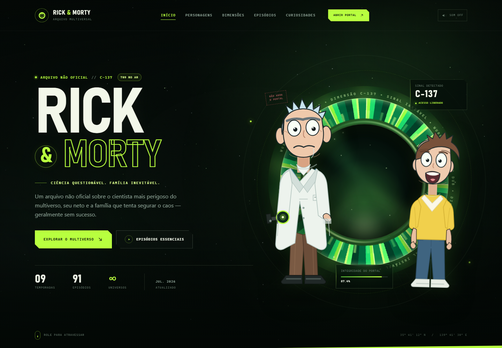

# Rick & Morty — Arquivo Multiversal C-137

Site de fãs em página única sobre **Rick and Morty**, feito com HTML, CSS e JavaScript puro — sem frameworks, sem build e sem dependências externas.



## Como abrir

Basta abrir o arquivo `index.html` no navegador. O site funciona localmente, inclusive por `file://`.

Se preferir servir com um servidor local:

```bash
npx serve .
# ou
python -m http.server 8000
```

## Estrutura

```text
.
├── index.html
├── css/
│   └── style.css
├── js/
│   └── main.js
├── assets/
│   └── favicon.svg
└── preview.png
```

## Recursos

- Hero com portal animado, estrelas em canvas e ilustrações vetoriais originais de Rick e Morty.
- Filtro de personagens por família Smith ou multiverso.
- Scanner de dimensões interativo com abas acessíveis por teclado.
- Arquivo de episódios com modal de detalhes e sorteio de episódio.
- Carrossel de citações com controles manuais, pausa e respeito a `prefers-reduced-motion`.
- Efeitos sonoros sintetizados com Web Audio API (opcionais).
- Layout responsivo, menu mobile com foco controlado, navegação por teclado e link de pular conteúdo.

## Créditos e notas

Site de fãs não oficial. *Rick and Morty* foi criado por Dan Harmon e Justin Roiland e é © Adult Swim / Warner Bros. Discovery. Sem afiliação.

Dados de episódios atualizados em julho de 2026, com base na [lista de episódios da Wikipedia](https://en.wikipedia.org/wiki/List_of_Rick_and_Morty_episodes).
